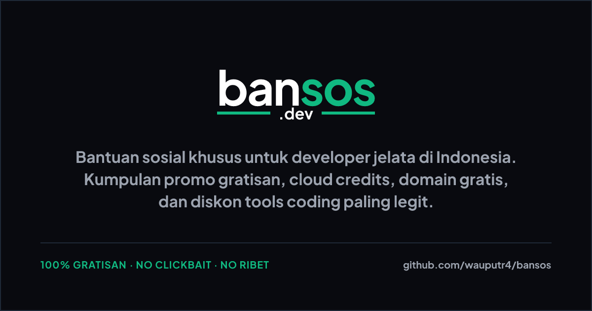

# bansos.dev

[](LICENSE)
[](https://kit.svelte.dev/)
[](https://bansos.dev/)
[](https://discord.gg/m4WFaQpNGs)
[](https://t.me/bansos_dev)
[](https://whatsapp.com/channel/0029Vb8ZXgW1Hsq7j1uhRm0G)



[**🇮🇩 Indonesia (Default)**](README.md) · [**🌐 English**](README.en.md)

---

# 🌏 English

`Social assistance for broke developers`

**bansos.dev** is an open-source catalog of giveaways, freebies, and the most legit coding tool discounts specifically for Indonesian broke developers. Made so our portfolios stay lit even when our wallets are dying. Looking for free domains, hosting free-tier, cloud credits, API credits, free databases, or startup credits? This is the gathering place! 100% Free, No Clickbait, No Hassle. fr fr 🚀

This site uses SvelteKit on Cloudflare Pages with a runtime D1 catalog, GitHub login, and admin approval. Repository data remains the base/fallback catalog; D1 publication does not require a rebuild. The dynamic implementation is under staging validation and is not yet released to production.

## Quick Keywords

`bansos developer`, `developer promo Indonesia`, `free domains`, `free cloud credits`, `API credits`, `hosting free tier`, `startup credits`, `free developer tools`, `open source Indonesia`, `SvelteKit static site`.

## Key Features

- Crawlable and easy-to-search developer bansos catalog.
- Listings for free domains, free cloud, hosting free-tier, API credits, database credits, and startup benefits.
- Detail pages with provider, benefits, claim requirements, validity period, active/expired status, and official links.
- Tag filters and featured/latest highlights.
- Per-listing data under [`src/lib/data/bansos/`](src/lib/data/bansos/).
- SEO metadata for public pages, including meta description and social card pattern.
- GitHub-authenticated submission form, owner dashboard, and admin moderation.
- Session-backed D1 comments, attributed Discussions imports, and recoverable deletion.
- Private admin Discord submission alerts and public approved-listing announcements, with durable queues and manual retry. Staging never sends real messages.
- Admin review-queue indicator refreshed every 60 seconds while the page is active.
- Public contribution page: [bansos.dev/contribute](https://bansos.dev/contribute).
- Terms and conditions: [bansos.dev/terms](https://bansos.dev/terms).

## Deploy and Hosting

Hosted on **Cloudflare Pages** using `@sveltejs/adapter-cloudflare`. Code changes still require build/deploy; publishing and moderating D1 content does not. GitHub previews do not automatically configure D1/OAuth. Use separate staging/production databases, OAuth Apps, and secrets; never expose production resources to untrusted PR code.

See [architecture/local setup](docs/dynamic-catalog.md), [staging](docs/staging-dynamic-catalog.md), [E2E evidence](docs/staging-e2e-2026-10-27.md), and [production preparation](docs/production-readiness.md). Full static snapshot export is not implemented; without a DB binding the repository catalog remains the fallback.

## Running the project

```bash
npm install
npm run dev
npm run build
```

Local validation:

```bash
npm run check
npm run lint
```

## Important structure

```text
src/lib/data/bansos/<slug>/    # index.json + README for each listing
src/lib/data/bansos/contributors/ # contributor profiles
src/lib/data/bansos.ts         # loader, selectors, sorting, and stats
src/lib/components/            # reusable UI components
src/routes/list/               # list and bansos detail pages
src/routes/contribute/         # public contribution guide
scripts/add-bansos.mjs         # local script to add data
packages/bansosdev-cli/        # Legacy CLI (public submissions disabled)
```

Every listing must have a `contributorSlug` linked bidirectionally to its profile manifest. Avatars
are derived from GitHub when available; profiles without GitHub still appear with two initials. All
contributor name links on the site point to the internal bansos.dev profile.
Profile content can be customized through `src/lib/data/bansos/contributors/<slug>/README.md`.
Public profiles use the canonical URL `https://bansos.dev/<slug>/`; validation prevents contributor
slugs from colliding with site routes or bansos shortlinks.

## How to Add Bansos

1. Open [Contribute](https://bansos.dev/contribute/) and sign in with GitHub.
2. Provide the program details, official source, requirements, and validity, then submit for review.
3. Track, revise, or withdraw submissions in Dashboard. Only admin approval publishes a listing.
4. Edits to owned listings require review; archiving hides them immediately. Featured remains admin-only.

AI Agent, Email, Git Clone, and npx CLI are not public submission tabs in this MVP. Repository data tools remain available for maintainer upkeep of the base catalog, not as a replacement for user moderation.

New comments live in D1. `scripts/import-discussions.mjs` supports one-way historical imports preserving numeric authors, dates, reply relationships, and source links. Imports do not create login users, mutate GitHub, or restore locally deleted comments. Never commit private snapshots.

## Listing Quality Guidelines

A good listing should include:

- Official link to the provider or program page.
- Specific benefits, such as credit amount, duration, or quota limits.
- Clear claim requirements.
- Status (active, expired, or upcoming).
- Tags that aid searching, e.g., `Cloud`, `Domain`, `AI Credits`, `Startup`, or `No Credit Card`.
- Contributor's name and URL.

## Contribution

- Submit listings through the GitHub-authenticated form for admin review.
- Code changes still use branches/PRs and maintainer review.
- Read the full contribution guide in [CONTRIBUTING](https://github.com/wauputr4/bansos/blob/main/.github/CONTRIBUTING.md).

## Community Code of Conduct

Please follow the [Code of Conduct](CODE_OF_CONDUCT.md).

## Sponsor & Support

The `bansos.dev` project is built for free by the community. If this project has helped you save your developer budget, feel free to send support via email to [me@wau.my.id](mailto:me@wau.my.id).

> [!NOTE]
> **Soon:** We plan to introduce a feature where donors/visitors can send support (donations) directly to the respective contributors who registered/wrote the bansos listing.

## License

MIT. See [LICENSE](LICENSE).

## Disclaimer

bansos.dev is an **open-source community platform** aimed at helping fellow Indonesian developers find legitimate and legal social assistance programs from official providers. We are not affiliated with any provider.

**We strictly prohibit:**

- Misuse of bansos information for **abuse** or exploiting provider policy/security loopholes.
- Violation of **Terms of Service (ToS)** of any platform or third-party provider.
- Actions that violate **data privacy** of individuals or organizations.
- Any form of **illegal activity** or violation of applicable law.
- Submitting **false, misleading, or unclaimable** bansos information.

All displayed information is for **reference only**. Always verify directly with the official provider site before claiming. We are not responsible for unilateral policy changes by providers, misinterpretation of benefits, or misuse of information by irresponsible parties.

By using bansos.dev, you agree that this platform is merely a **community catalog** and all claims, transactions, or interactions with providers are entirely the personal responsibility of each user.
